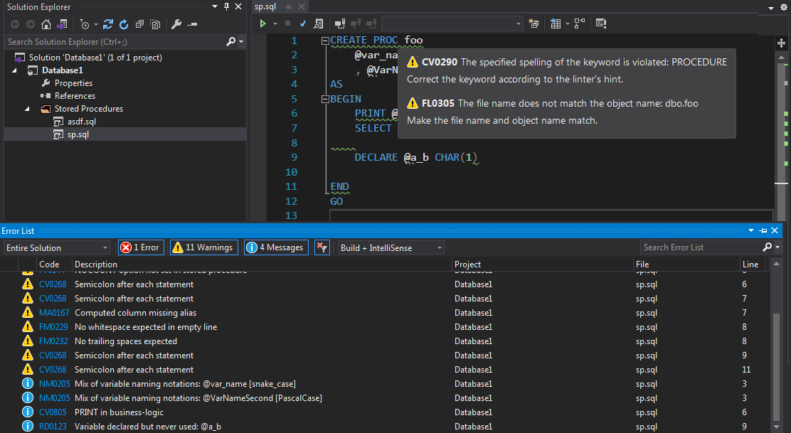
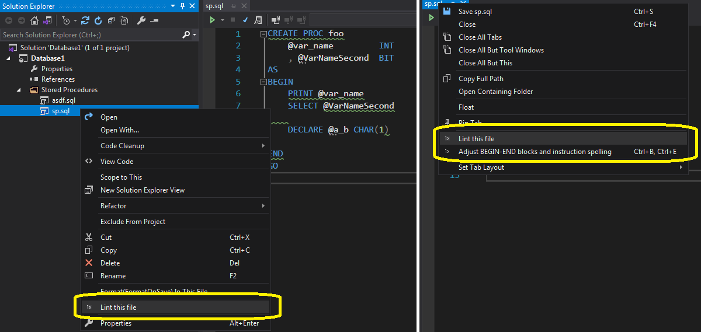
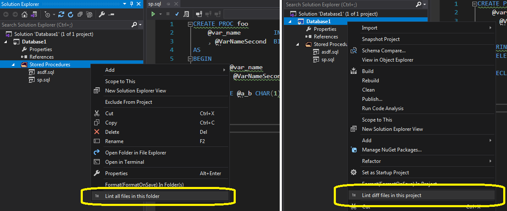


# TeamTools T-SQL Linter Visual Studio Extension

This extension integrates [IVNSTN/TeamTools.Linter.TSQL](https://github.com/IVNSTN/TeamTools.Linter.TSQL) for static analysis of **T-SQL** code with Visual Studio.

It is compatible with **VS 2019** and **VS 2022**. Build for VS 2022 should work fine in **VS 2026**, build for VS 2019 should work fine in **VS 2017**.

## Installation

The T-SQL linter extension for Visual Studio can be installed from the official marketplace ([2019](https://marketplace.visualstudio.com/items?itemName=IVNSTN.ivnstntsqllinter2019), [2022](https://marketplace.visualstudio.com/items?itemName=IVNSTN.ivnstntsqlextension2022))
or by downloading, unpacking, and manually installing the most recent binary from the *Releases* section of the project's GitHub page.

## How it works

After installation, the linter automatically runs code validation during SQL project code editing in Visual Studio.
It scans the currently active tab with a `.sql` file and detects *code smells* and other rule violations. Detected violations
are displayed in the **Error List** tab and highlighted in the active editor tab:

You can force a single-file scan by clicking the **"Lint this file"** menu item in the context menu shown on an editor tab
or on a single file in *Solution Explorer*.

It is also possible to run linting on multiple files: click **"Lint all files in this folder"** in the context menu
shown on a folder selected in *Solution Explorer*, or **"Lint diff files of this project"**.

**"Lint diff files"** is available for projects located inside a Git repository. It scans all files considered *different*
from the *main* branch state.

## Limitations

Currently, the Visual Studio version of the T-SQL linter does not provide a configuration UI. It can be configured by editing the `DefaultConfig.json` configuration
file located in the VSIX installation folder.

## CLI tool

It is also possible to run code analysis in a terminal: the T-SQL linter is available as a command-line tool. Thus, it can be:

- configured as an external tool for VS, SSMS, or SourceTree;
- integrated into a pre-commit hook script to prevent committing source files that violate active rules.

See the [command-line version](https://github.com/IVNSTN/TeamTools.Linter.CommandLine) homepage for additional details.

## License

MIT
